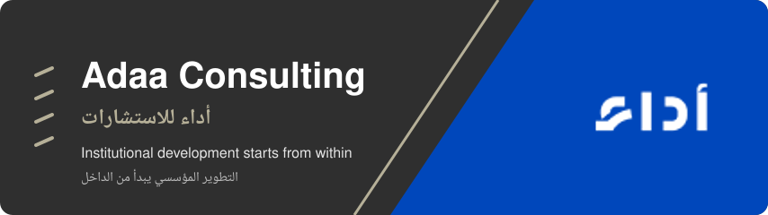
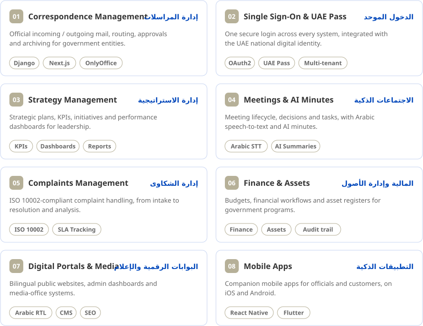
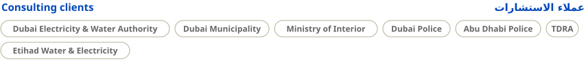
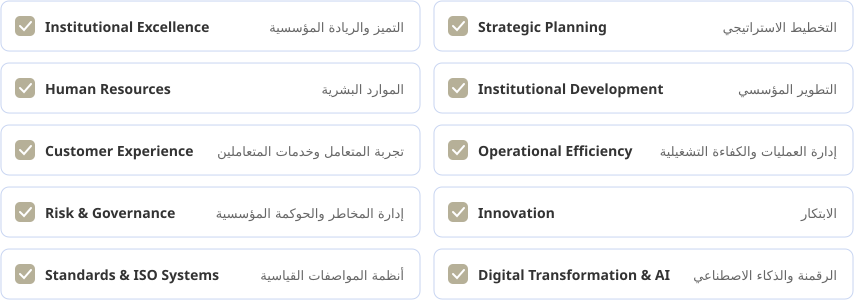

  
  
  
  

---

### About Adaa

**Adaa Consulting** is a UAE-based institutional development house with offices in **Abu Dhabi, Dubai, Fujairah, and Riyadh**. We help government entities and organizations raise their performance, combining management consulting with in-house **digital solutions** built for Arabic-first, government-grade environments.

Our engineering team designs, builds, and runs the platforms our clients depend on every day: secure, bilingual, and integrated with **UAE Pass**.

### What We Build

<picture>
  <source media="(prefers-color-scheme: dark)" srcset="brand/products-dark.svg"/>
  
</picture>

### Who We Work With

<picture>
  <source media="(prefers-color-scheme: dark)" srcset="brand/clients-dark.svg"/>
  
</picture>

### Consulting Expertise

<picture>
  <source media="(prefers-color-scheme: dark)" srcset="brand/services-dark.svg"/>
  
</picture>

### Technology

  

Arabic-first RTL interfaces · UAE Pass &amp; OAuth2 SSO · Multi-tenant SaaS · On-premise AI (Arabic speech-to-text) · ISO-aligned workflows

---

### عن أداء

**أداء للاستشارات** بيت خبرة إماراتي في التطوير المؤسسي، بمكاتب في **أبوظبي ودبي والفجيرة والرياض**. نساعد الجهات الحكومية والمؤسسات على الارتقاء بأدائها من خلال الاستشارات الإدارية وحلول رقمية نطوّرها داخلياً لتلائم بيئة العمل الحكومي باللغة العربية أولاً.

**حلولنا الرقمية:** إدارة المراسلات · الدخول الموحد عبر الهوية الرقمية (UAE Pass) · إدارة الاستراتيجية ومؤشرات الأداء · إدارة الاجتماعات والمحاضر الذكية · إدارة الشكاوى (ISO 10002) · المالية وإدارة الأصول · البوابات الرقمية والإعلام · التطبيقات الذكية

---

